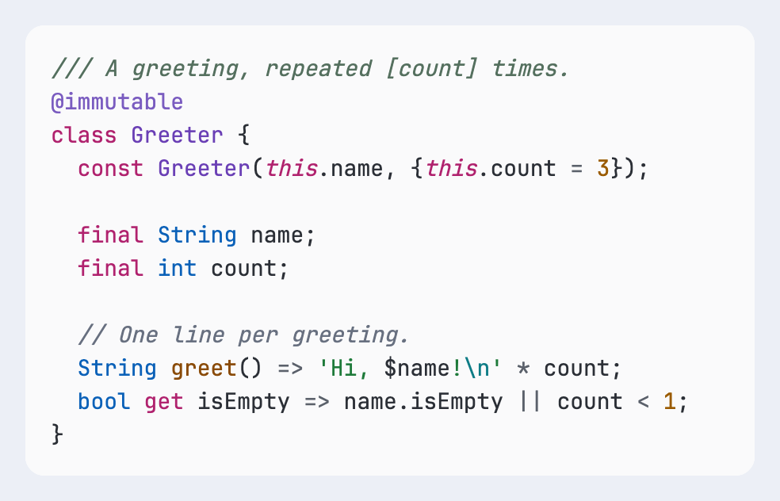
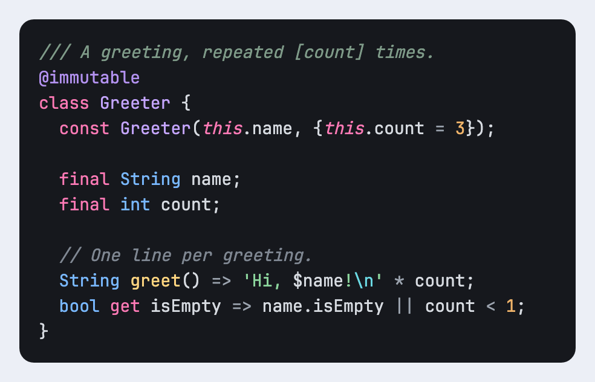
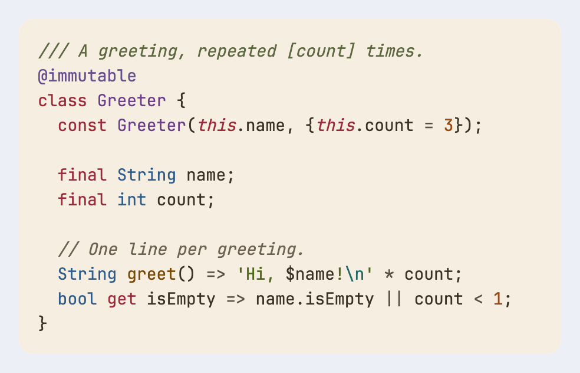
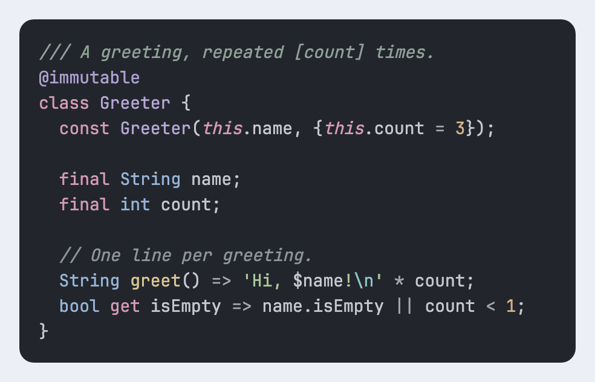
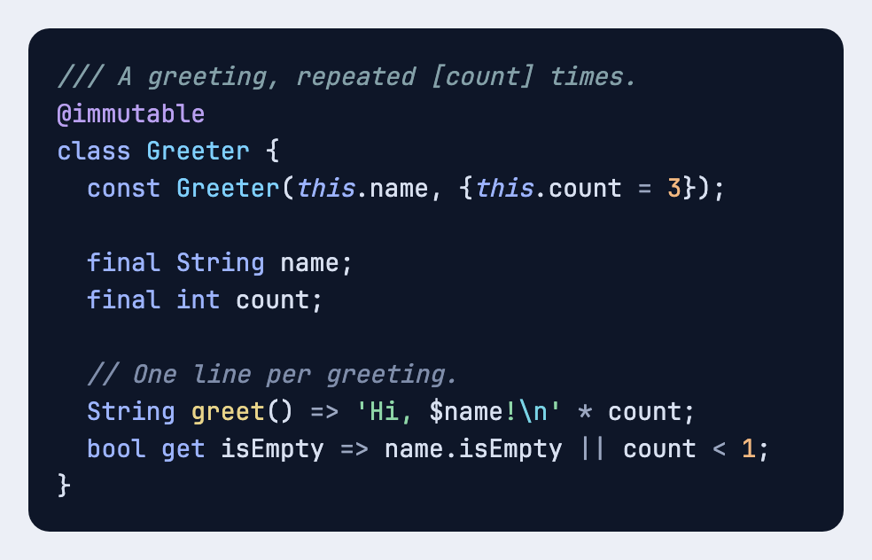
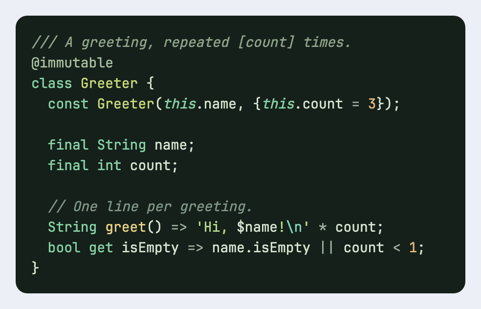
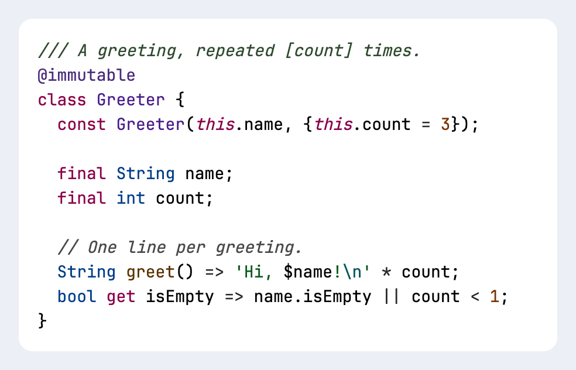
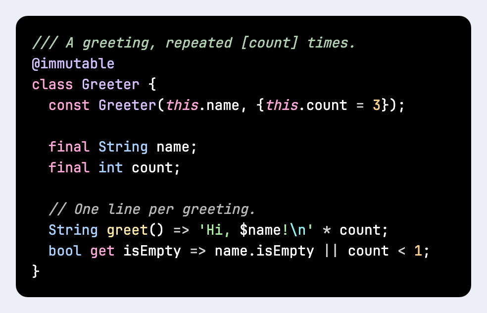

{/* Generated by `dart run tool/docs/api_reference.dart` in val_highlight_flutter/. Do not edit. */}
import { TabItem, Tabs } from '@astrojs/starlight/components'

<Tabs>
<TabItem label="Light">

</TabItem>
<TabItem label="Dark">

</TabItem>
<TabItem label="Sepia">

</TabItem>
<TabItem label="Dim">

</TabItem>
<TabItem label="Midnight">

</TabItem>
<TabItem label="Forest">

</TabItem>
<TabItem label="High contrast light">

</TabItem>
<TabItem label="High contrast dark">

</TabItem>
</Tabs>
