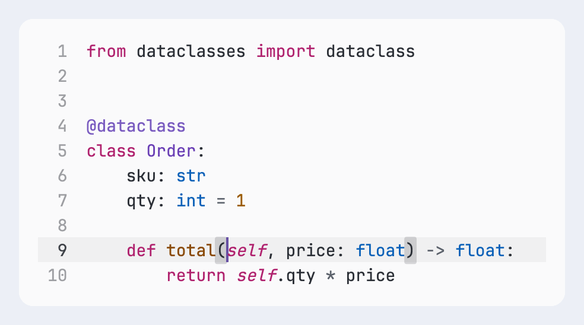

import { Code, TabItem, Tabs } from '@astrojs/starlight/components'
import editor from '../../val_highlight_flutter/tool/screenshots/examples/code_field/editor.dart?raw'
import Api from '../api/_code-field.mdx'

<Tabs>
<TabItem label="Preview">

</TabItem>
<TabItem label="Code">
<Code code={editor} lang="dart" />
</TabItem>
</Tabs>

In the preview the caret has been put after `total(`: the caret's line is
highlighted, and the parenthesis before the caret and its match are marked.

## Usage

`CodeField` is a multi-line `TextField` for code. Its text, language and theme
live in a `HighlightTextController`: create it once, change
`controller.language` or `controller.theme` whenever you like, and dispose it
with the widget that owns it. `controller.result` is the current
`HighlightResult`.

`CodeField` paints no background, so paint the theme's behind it, as the
example does. `CodeTheme.resolve(context, controller.theme)` returns the
theme the field uses. Its default `decoration` has no border and no padding.

Each edit re-highlights only the lines it can affect — see
[incremental highlighting](/docs/engine/incremental/).

## What typing does

With the defaults:

- **Brackets and quotes close themselves** when the caret is followed by
  whitespace, the end of the text, or one of `) ] } > ; : , . =`. Typing the
  closer steps over an automatic one, and Backspace between an empty
  automatic pair deletes both.
- **Quotes stay single** after a letter or digit, so `don't` is left alone,
  and inside strings and comments.
- **Typing a bracket or quote over a selection** wraps the selection.
- **Enter** keeps the current line's indentation, and adds one level after
  `{`, `[`, `(` or `:`. Between a pair, as in `{|}`, the closer moves to its
  own line below the caret.
- **Tab** inserts one indent at the caret, or replaces a selection within a
  line; with a selection across lines it indents every non-empty line.
  **Shift+Tab** removes one indent from each line the selection touches.
- **Ctrl+/** (**Cmd+/** on macOS and iOS) comments the lines the selection
  touches, or uncomments them when every non-blank one already starts with
  the comment marker. Markers line up at the smallest indentation, and blank
  lines are left alone. Doc comments (`///`, `//!`) and shebangs are
  commented out like any other line rather than taken for comments. A
  language with only block comments, such as CSS or HTML, wraps the
  selection — or the caret's line — in them.
- **The bracket next to the caret and its match** get a background. The one
  before the caret is tried first.
- Autocorrect, suggestions, smart quotes and smart dashes are off.

Brackets, quotes and comment markers come from the language's
[`EditingSyntax`](/docs/customize/writing-a-grammar/#editing-syntax), so
Python comments with `#`, SQL with `--`, and Rust doesn't pair `'`, which
also starts a lifetime. Typing is handled as text changes, not key presses,
so it behaves the same on hardware keyboards, on-screen keyboards and voice
input. Text an input method is still composing is never changed.

## Configure editing

Turn single behaviors off with a `CodeEditing`, or all of them with
`CodeEditing.none`:

```dart
CodeField(
  controller: controller,
  editing: const CodeEditing(autoClose: false),
)
```

`syntax` replaces the language's comment markers, brackets and quotes, and
`indent` sets what Tab inserts and Shift+Tab removes — two spaces by default:

```dart
CodeField(
  controller: controller,
  indent: '    ',
  editing: CodeEditing(
    syntax: EditingSyntax.cStyle.copyWith(quotes: '"\'`'),
  ),
)
```

## Line numbers and line highlights

```dart
CodeField(
  controller: controller,
  lineNumbers: true,
  highlightCurrentLine: true,
  highlightedLines: {3, 4},
)
```

The gutter, the line bands and the bracket marks are painted from the text's
own layout, so they line up with wrapped lines, only visible lines are
painted, and they follow the text when a font finishes loading late. The
gutter has room for at least two digits and widens when the line count gains
one. `firstLineNumber`, `gutterStyle`, `highlightColor`, `currentLineColor`
and `bracketColor` change the rest; see the [API reference](#codefield).

## Shortcuts

Each shortcut sends an intent: `IndentCodeIntent` (Tab), `OutdentCodeIntent`
(Shift+Tab) and `ToggleCommentIntent` (Ctrl+/ or Cmd+/). The defaults are in
`CodeField.defaultShortcuts`. Rebind keys with `shortcuts`, or pass
`const {}` to remove them all, so Tab moves focus as in any other field:

```dart
CodeField(controller: controller, shortcuts: const {})
```

To change what an intent does, put an `Actions` widget above the field:

```dart
Actions(
  actions: {
    ToggleCommentIntent: CallbackAction<ToggleCommentIntent>(
      onInvoke: (_) => myToggle(),
    ),
  },
  child: CodeField(controller: controller),
)
```

The comment toggle is also a function, `toggleComment`, which takes a
`TextEditingValue` and an `EditingSyntax` and returns the new value — or
`null` when the language has no comments. Pass `result` so a marker inside a
string is not taken for a comment:

```dart
final updated = toggleComment(
  controller.value,
  EditingSyntax.of(controller.language),
  result: controller.result,
);
if (updated != null) controller.value = updated;
```

## Undo

`undoController` is the field's undo history, as on a `TextField`. Every edit
the field makes itself — an auto-closed pair, a toggled comment, an indent —
is one undo step.

## Large documents

Flutter lays out a text field's whole text on every change, and styled runs
make that slower. So for a document of more than `styleAllBelow` lines (300
by default), `CodeField` colors only the visible lines plus `margin` lines
on each side (150 by default), and the rest is plain text. The colored
window follows scrolling — the field's own, or that of a scroll view around
it. Moving the window lays the whole field out again, so while you scroll it
moves only when the visible lines come close to its edge, and it is centered
again once scrolling stops.

## API reference

<Api />
