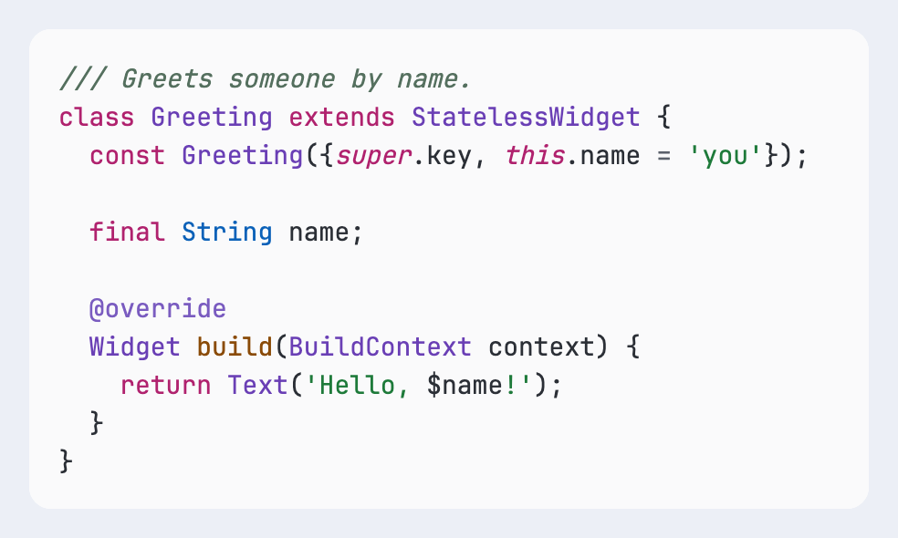
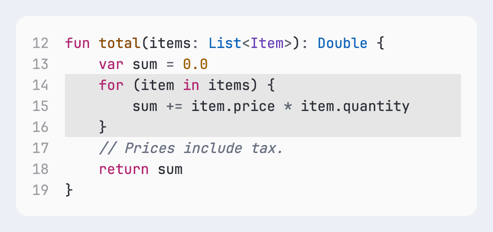
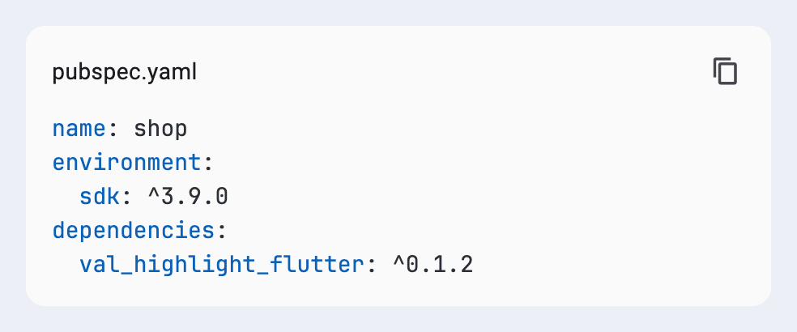
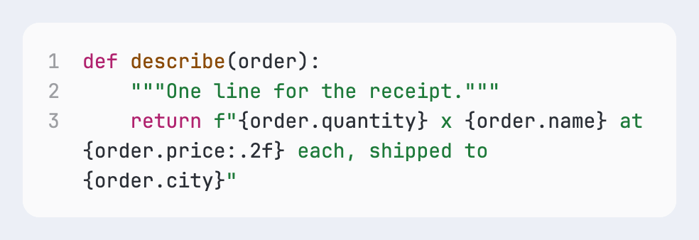
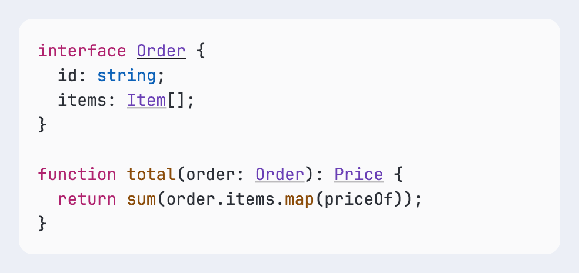
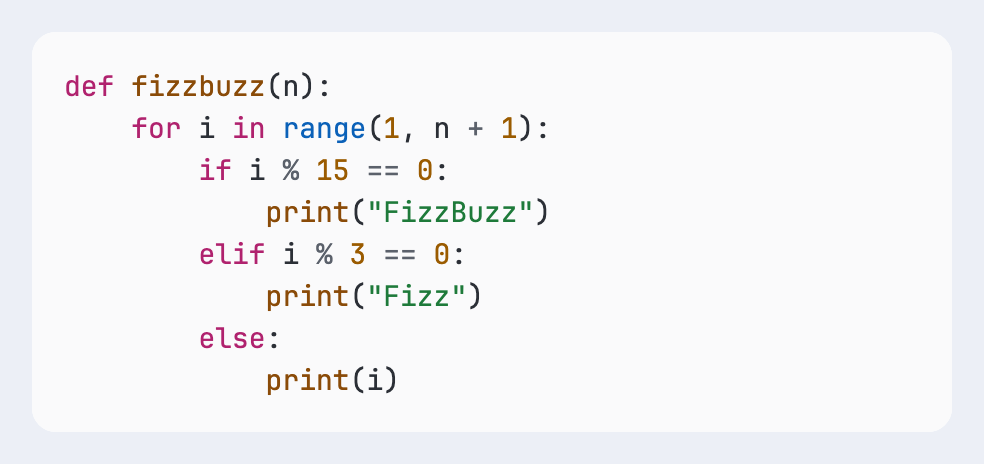
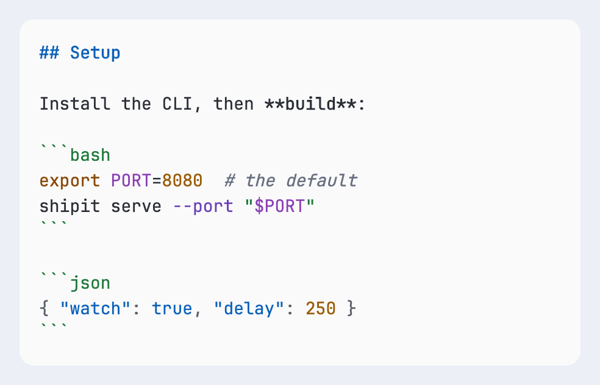

import { Code, TabItem, Tabs } from '@astrojs/starlight/components'
import basic from '../../val_highlight_flutter/tool/screenshots/examples/code_view/basic.dart?raw'
import lineNumbers from '../../val_highlight_flutter/tool/screenshots/examples/code_view/line_numbers.dart?raw'
import header from '../../val_highlight_flutter/tool/screenshots/examples/code_view/header.dart?raw'
import wrap from '../../val_highlight_flutter/tool/screenshots/examples/code_view/wrap.dart?raw'
import spanBuilder from '../../val_highlight_flutter/tool/screenshots/examples/code_view/span_builder.dart?raw'
import detect from '../../val_highlight_flutter/tool/screenshots/examples/code_view/detect.dart?raw'
import markdown from '../../val_highlight_flutter/tool/screenshots/examples/code_view/markdown.dart?raw'
import Api from '../api/_code-view.mdx'

<Tabs>
<TabItem label="Preview">

</TabItem>
<TabItem label="Code">
<Code code={basic} lang="dart" />
</TabItem>
</Tabs>

## Usage

```dart
import 'package:val_highlight/languages/dart.dart';
import 'package:val_highlight_flutter/val_highlight_flutter.dart';

CodeView(source, language: dartLanguage)
```

Give it the source and a language; every other parameter is optional. With
the defaults, the theme follows the platform's brightness (or a
[`CodeTheme`](/docs/themes/#app-wide-defaults)), long lines scroll sideways,
and the code sits in 16 pixels of the theme's background color. Code is
always laid out left to right, even in a right-to-left app.

To let people select and copy the code, put it — or the page around it —
in a `SelectionArea`:

```dart
SelectionArea(child: CodeView(source, language: dartLanguage))
```

## Examples

### Line numbers and highlighted lines

<Tabs>
<TabItem label="Preview">

</TabItem>
<TabItem label="Code">
<Code code={lineNumbers} lang="dart" />
</TabItem>
</Tabs>

`firstLineNumber` sets the number of the first line, for an excerpt of a
longer file, and `highlightedLines` takes the numbers as shown in the gutter.
Without `highlightColor`, highlighted lines get a translucent band: black at
8% opacity in a light theme, white at 13% in a dark one. Line numbers are
never selected, so copying the code never copies them, and screen readers
skip them.

To draw the gutter yourself, pass a `gutterBuilder`. It gets a
`CodeLineDetails` — the zero-based `line`, its `lineNumber` as shown, and
whether it is `highlighted` — and is only used while `lineNumbers` is on.
Return a fixed-width widget so the rows stay aligned:

```dart
CodeView(
  source,
  language: dartLanguage,
  lineNumbers: true,
  gutterBuilder: (context, line) => SizedBox(
    width: 32,
    child: Text(
      '${line.lineNumber}',
      textAlign: TextAlign.right,
      style: TextStyle(fontWeight: line.highlighted ? FontWeight.bold : null),
    ),
  ),
)
```

`lineBuilder` wraps each row the same way, with the row as `child` — for a
gesture detector per line, say. Setting it lays the code out one row per
line.

:::note
Placed where its height is bounded, such as in an `Expanded`, a `CodeView`
with line numbers fills that height, its background included. Without line
numbers it is as tall as its code. In a scrolling page both are as tall as
the code.
:::

### A header

<Tabs>
<TabItem label="Preview">

</TabItem>
<TabItem label="Code">
<Code code={header} lang="dart" />
</TabItem>
</Tabs>

`header` places any widget above the code, on the code's background — a file
name, a language label, a copy button. `padding` applies to the code below
it; the example trims its top so the header sits close to the code.

### Wrapping

<Tabs>
<TabItem label="Preview">

</TabItem>
<TabItem label="Code">
<Code code={wrap} lang="dart" />
</TabItem>
</Tabs>

`wrap: true` wraps long lines instead of scrolling them sideways. With line
numbers or highlighted lines, wrapped code is laid out one row per line, so
each number stays beside the first row of its line.

### Custom spans

<Tabs>
<TabItem label="Preview">

</TabItem>
<TabItem label="Code">
<Code code={spanBuilder} lang="dart" />
</TabItem>
</Tabs>

`spanBuilder` builds the span of every token, for links, hover effects,
tooltips or your own styling. `style` is the token's themed style, or `null`
for plain text. Keep `text: token.text`, or the code on screen changes.

To react to taps instead, pass `onTokenTap`. Whitespace is not tappable; if
both are set, `spanBuilder` wins.

```dart
CodeView(
  source,
  language: dartLanguage,
  onTokenTap: (token) {
    if (token.scope == Scopes.type) openDefinition(token.text);
  },
)
```

A `CodeToken` is one run of text with the same scopes, never crossing a line
break. A whole comment is one token: `// TODO: ship` is a single `comment`
token, so look inside `token.text` to find words within a comment or string.

### Unknown languages

<Tabs>
<TabItem label="Preview">

</TabItem>
<TabItem label="Code">
<Code code={detect} lang="dart" />
</TabItem>
</Tabs>

`language` is optional. Without it, `CodeView` runs
[language detection](/docs/engine/lookup/#detect-a-language) over the
candidates in `detectLanguages`. When that finds nothing — or
`detectLanguages` is empty, the default — it uses `fallbackLanguage`, which
is `genericLanguage`: comments, strings, numbers, common keywords, types,
calls and operators, the things most languages share.

```dart
// No highlighting at all for code in an unknown language.
CodeView(snippet, fallbackLanguage: plainTextLanguage)
```

Detection is a guess. When you know the language, pass it.

### Languages inside languages

<Tabs>
<TabItem label="Preview">

</TabItem>
<TabItem label="Code">
<Code code={markdown} lang="dart" />
</TabItem>
</Tabs>

HTML highlights `<style>` as CSS and `<script>` as JavaScript with no setup.
Markdown highlights each fenced block in the language named on its fence,
which it looks up in a registry: give `CodeView` a `CodeHighlighter` that has
one. Without a registry, fenced code is shown in the plain `code` scope.

## Long files

`CodeView` lays short code out as one block of text. When the code has more
than `virtualizeAbove` lines (1,000 by default) and the view's height is
bounded — inside an `Expanded` or a `SizedBox`, say — it switches to a lazy
list that builds only the rows on screen. Pass `scrollController` to control
that list. In an unbounded height, such as a `Column` without `Expanded` or a
`ListView`, the code is never laid out lazily.

```dart
Expanded(
  child: CodeView(
    largeSource,
    language: dartLanguage,
    lineNumbers: true,
    virtualizeAbove: 500,
  ),
)
```

Code of 50,000 characters or more is highlighted in a background isolate
while it shows as plain text; on the web, which has no isolates, it is
highlighted on a later turn of the event loop instead. Results are cached by
code and language — the 32 most recent, by default — so showing the same code
again does not highlight it again.

## The highlighter

Every `CodeView` uses `CodeHighlighter.shared` unless you pass `highlighter`.
Create your own to change the isolate threshold or the cache size, or to give
it a language registry for Markdown fences:

```dart
final highlighter = CodeHighlighter(
  registry: allLanguagesRegistry(),
  isolateThreshold: 100000,
  cacheSize: 64,
);
```

A language is compiled the first time it is used. To do that before the
first code appears, preload the languages you expect; each is compiled as an
idle-priority task, one at a time:

```dart
CodeHighlighter.shared.preload([dartLanguage, kotlinLanguage, jsonLanguage]);
```

`clearCache()` empties the result cache.

## Themes and text style

`theme` picks a `ValTheme` for one view; without it, `CodeView` follows
`CodeTheme` and the brightness. `style` is merged over the default code
style — `monospace` at 14 pixels with a line height of 1.5 — for example to
set a font family. See [Themes](/docs/themes/).

## API reference

<Api />
