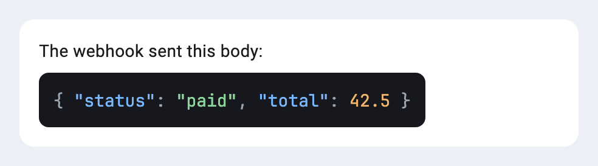

import { Code, TabItem, Tabs } from '@astrojs/starlight/components'
import inlineSpans from '../../val_highlight_flutter/tool/screenshots/examples/rendering/inline_spans.dart?raw'
import Api from '../api/_rendering.mdx'

<Tabs>
<TabItem label="Preview">

</TabItem>
<TabItem label="Code">
<Code code={inlineSpans} lang="dart" />
</TabItem>
</Tabs>

When `CodeView` is more than you need — a line of code inside a chat message,
a cell in a table, a widget of your own — build the spans yourself. These are
the pieces `CodeView` and `HighlightTextController` are made of.

## The pieces

1. **A `HighlightResult`**, from `Highlighter`, or from a `CodeHighlighter`
   for its cache and background isolates. A result is plain data: highlight
   once and keep it.
2. **A `CodeStyles`** for a theme. It resolves each scope stack's style once,
   with the inherited styles merged, and caches it. Make one per theme and
   keep it.
3. **Spans**, from one of three functions:

| Function | Gives you |
|---|---|
| `lineSpans(result, line, styles)` | The spans of one line, without its line break. For one widget per line. |
| `documentSpans(result, styles)` | Every line, joined with `\n`. The `\r` of a `\r\n` line break is dropped, so it never renders. |
| `exactSpans(result, styles)` | Spans that cover every character exactly, as a text field needs. It can underline the composing range, and color only part of the text. |

Plain text gets no style of its own, so it takes the style of the span
around it. Use `styles.rootStyle(base)` for that: your base style with the
theme's text color. The theme's background is left out — paint it on the
container, as the example does.

`textStyleFromStyle` converts a single `Style` from a theme into a
`TextStyle`, leaving unset fields unset.

## API reference

<Api />
