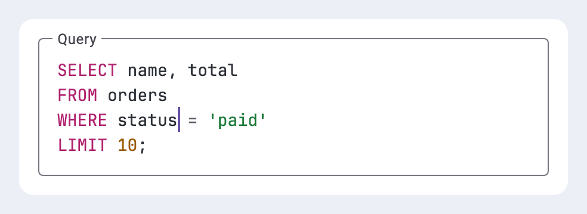

import { Code, TabItem, Tabs } from '@astrojs/starlight/components'
import query from '../../val_highlight_flutter/tool/screenshots/examples/text_field/query.dart?raw'
import Api from '../api/_text-field.mdx'

<Tabs>
<TabItem label="Preview">

</TabItem>
<TabItem label="Code">
<Code code={query} lang="dart" />
</TabItem>
</Tabs>

## Usage

`HighlightTextController` is a `TextEditingController` that highlights its
text, so any `TextField` can use it — with your own `InputDecoration`, label
and border, as in the example. Each edit re-highlights only the lines it can
affect.

```dart
final controller = HighlightTextController(
  language: sqlLanguage,
  text: 'SELECT 1;',
);
```

| Parameter | What it does |
|---|---|
| `language` | Required. The grammar to highlight with. Set `controller.language` later to switch; the text is highlighted again. |
| `text` | The initial text. |
| `theme` | A `ValTheme`. Without one, the controller follows `CodeTheme` and the brightness. Settable as `controller.theme`. |
| `registry` | A `LanguageRegistry` that resolves languages named inside the text, such as Markdown code fences. |

Give the field a monospace style: `CodeTheme.textStyleOf(context)` is the one
the package's widgets use.

## Typing like CodeField

`CodeEditingFormatter` brings `CodeField`'s typing to a plain `TextField`:
brackets and quotes that close themselves, typing over a selection to wrap
it, and Enter that keeps the indentation. Add it to `inputFormatters`, as the
example does. It takes `editing` and `indent`, like `CodeField`. What it
remembers between edits is kept on the controller, so creating it in
`build`, as the example does, is fine.

Keys are `CodeField`'s own: a plain `TextField` gets no Tab, Shift+Tab or
Ctrl+/ shortcuts, no bracket marks and no line numbers. When you need those,
use [CodeField](/docs/components/code-field/).

## Long text

A plain `TextField` colors the whole text, and Flutter lays all of it out on
every change, which gets slow after a few hundred lines. For long text, use
[`CodeField`](/docs/components/code-field/#large-documents), which colors
only the lines on screen.

## API reference

<Api />
