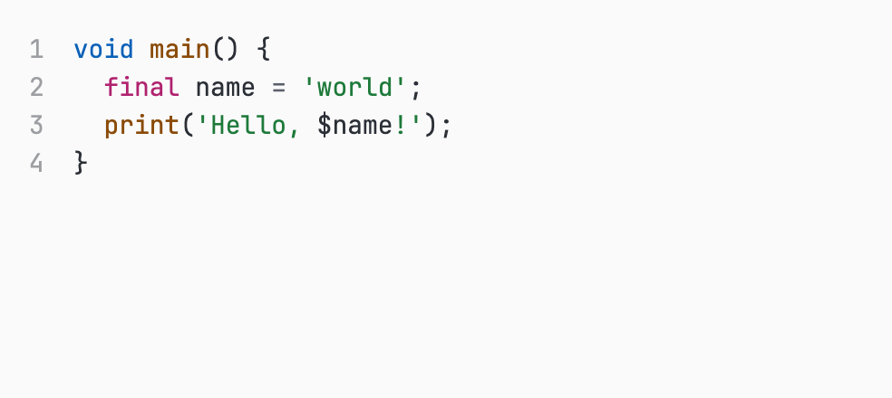

import { Code, TabItem, Tabs } from '@astrojs/starlight/components'
import app from '../val_highlight_flutter/tool/screenshots/examples/getting_started/app.dart?raw'
import Libraries from './api/_libraries.mdx'

Pick the package that matches your project: `val_highlight_flutter` for a
Flutter app, `val_highlight` for pure Dart — a server, a command-line tool or
a static site generator. Coming from a 0.x version? See
[Upgrading to 1.0](/docs/upgrading/).

## Install

<Tabs syncKey="platform">
<TabItem label="Flutter">
```bash
flutter pub add val_highlight_flutter val_highlight
```

A Flutter app lists `val_highlight` too, because languages and themes are
imported from `package:val_highlight/…`, and Dart's recommended lints
(`depend_on_referenced_packages`) flag imports from a package you don't
depend on.

The examples on these pages build their apps with
[`material_ui`](https://pub.dev/packages/material_ui), Flutter's Material
library as a package (`flutter pub add material_ui`). Apart from
`CodeField`, the widgets work the same with `package:flutter/material.dart`
or any other design system.
</TabItem>
<TabItem label="Dart">
```bash
dart pub add val_highlight
```
</TabItem>
</Tabs>

| Package | Requires |
|---|---|
| `val_highlight` | Dart 3.9 or later. No Flutter and no `dart:io`, so it runs on the Dart VM, in Flutter and on the web. |
| `val_highlight_flutter` | Flutter 3.44.0 or later, with Dart 3.12 or later. |

## Show code in Flutter

<Tabs>
<TabItem label="Preview">

</TabItem>
<TabItem label="Code">
<Code code={app} lang="dart" title="lib/main.dart" />
</TabItem>
</Tabs>

`CodeView` takes the source and a language; everything else is optional.
Its theme follows the platform's brightness — `lightTheme` in light mode,
`darkTheme` in dark mode — and long lines scroll sideways. To follow your
app's own light and dark mode instead, add a `CodeTheme`; see
[app-wide defaults](/docs/themes/#app-wide-defaults). To let people select
and copy the code, put it — or the page around it — in a `SelectionArea`.
[CodeView](/docs/components/code-view/) shows the rest; to let people edit
code, see [CodeField](/docs/components/code-field/).

### Which library to import

| Import | Use it for |
|---|---|
| `package:val_highlight_flutter/val_highlight_flutter.dart` | `CodeView`, `HighlightTextController`, `CodeTheme` and the rest. Built on Flutter's widgets layer only, so it works in any app: `package:flutter/material.dart`, [`material_ui`](https://pub.dev/packages/material_ui), Cupertino or your own design system. |
| `package:val_highlight_flutter/material.dart` | All of the above, plus `CodeField`, an editor built on `material_ui`'s `TextField`. It needs a `material_ui` `MaterialApp` above it. In other apps, give your own text field a `HighlightTextController`; see [highlighted TextField](/docs/components/text-field/). |

## Render HTML in Dart

```dart
import 'package:val_highlight/val_highlight.dart';
import 'package:val_highlight/languages/dart.dart';
import 'package:val_highlight/themes/light.dart';

void main() {
  const source = 'final n = 42; // answer';

  // HTML with CSS classes, and the stylesheet for those classes.
  final html = const Highlighter().toHtml(
    source,
    language: dartLanguage,
    renderer: const HtmlRenderer(wrap: true),
  );
  final css = lightTheme.toCss();

  print(html);
  print(css);
}
```

The HTML it prints:

```html
<pre class="vh"><code><span class="vh-keyword">final</span> n <span class="vh-operator">=</span> <span class="vh-number">42</span>; <span class="vh-comment">// answer</span></code></pre>
```

The stylesheet starts with `.vh{color:#2b2f36;background-color:#fafafb;}` and
has a rule per scope, such as `.vh .vh-keyword{color:#b0226e;}`. To do without
a stylesheet, write inline styles instead — see
[HTML output](/docs/engine/html/).

## Imports

| Import | Gives you |
|---|---|
| `package:val_highlight_flutter/val_highlight_flutter.dart` | The Flutter widgets except `CodeField`, plus everything in `val_highlight.dart`. |
| `package:val_highlight_flutter/material.dart` | Everything in `val_highlight_flutter.dart`, plus `CodeField`. |
| `package:val_highlight/val_highlight.dart` | The engine: `Highlighter`, `HighlightResult`, `IncrementalHighlighter`, `HtmlRenderer`, `LanguageRegistry`, `LanguageDetector`, `ValTheme`, `Style`, `Scopes`, `EditingSyntax` and more. |
| `package:val_highlight/advanced.dart` | The engine plus the rules and building blocks for [writing a grammar](/docs/customize/writing-a-grammar/). |
| `package:val_highlight/languages/<name>.dart` | One language, such as `languages/kotlin.dart` for `kotlinLanguage`. [Every language](/docs/languages/) lists its file. |
| `package:val_highlight/languages/all.dart` | Every language, the list `allLanguages`, and `allLanguagesRegistry()`. |
| `package:val_highlight/themes/<name>.dart` | One theme, such as `themes/midnight.dart` for `midnightTheme`. |
| `package:val_highlight/themes/all.dart` | Every theme, and the list `allThemes`. |

Each language and theme is a separate library of `const` values, so an app
includes only the ones it imports — `languages/all.dart` includes them all.

What each library's own documentation says:

<Libraries />
