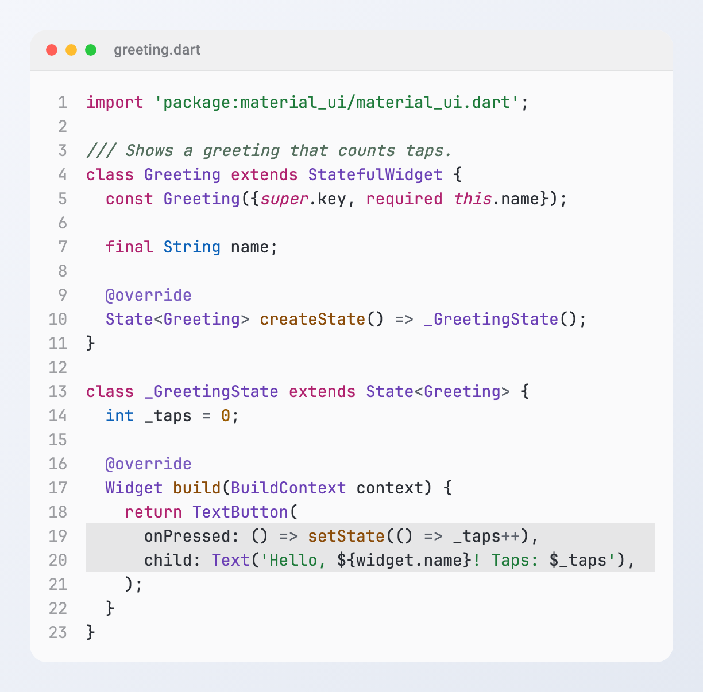
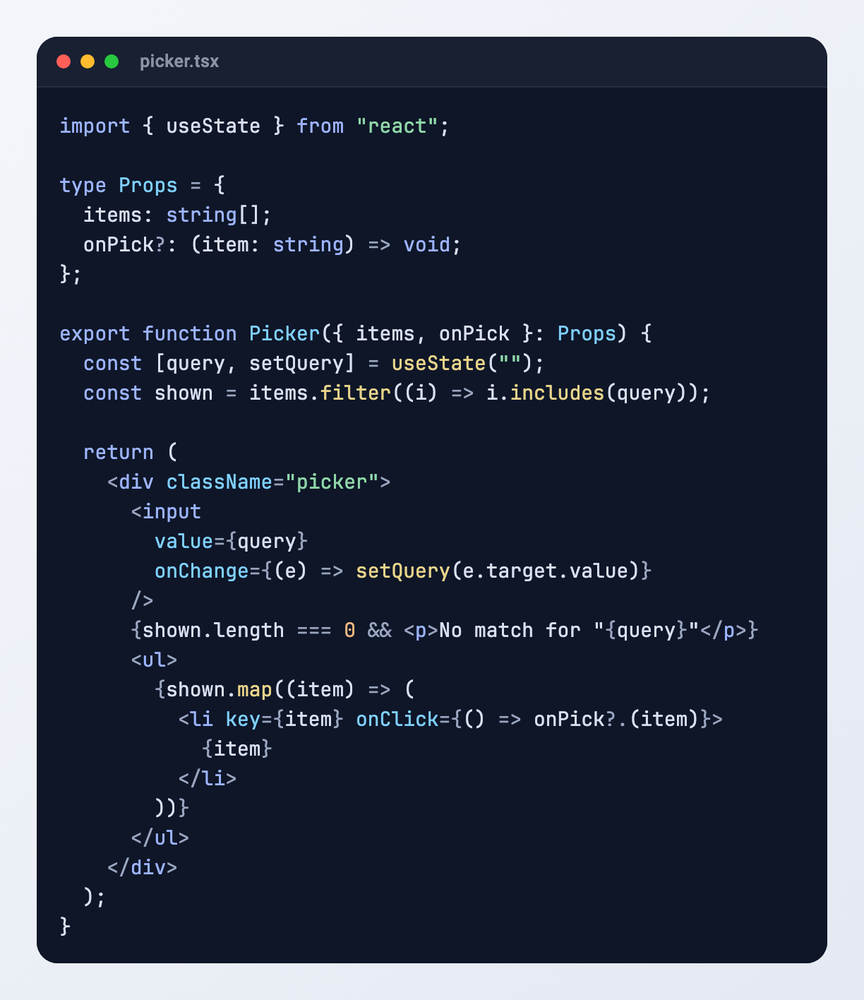
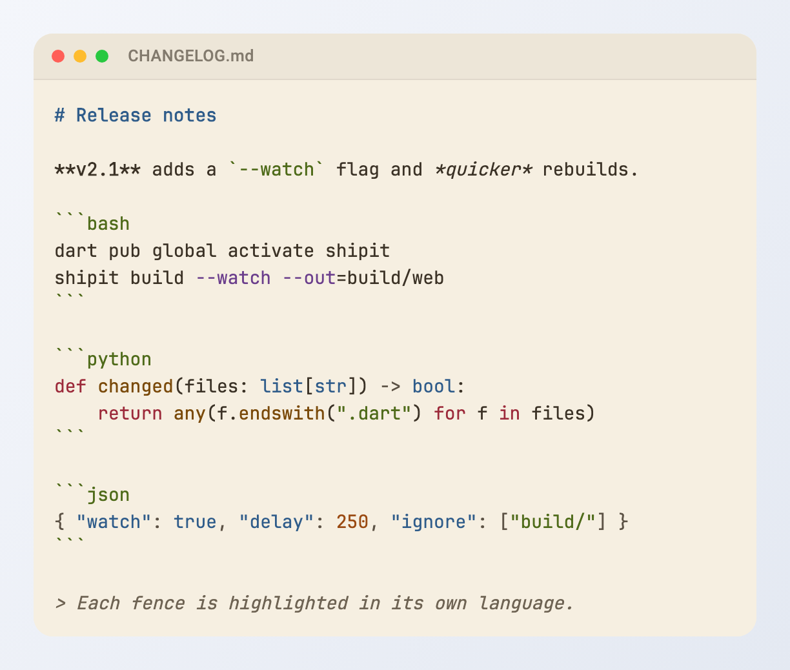
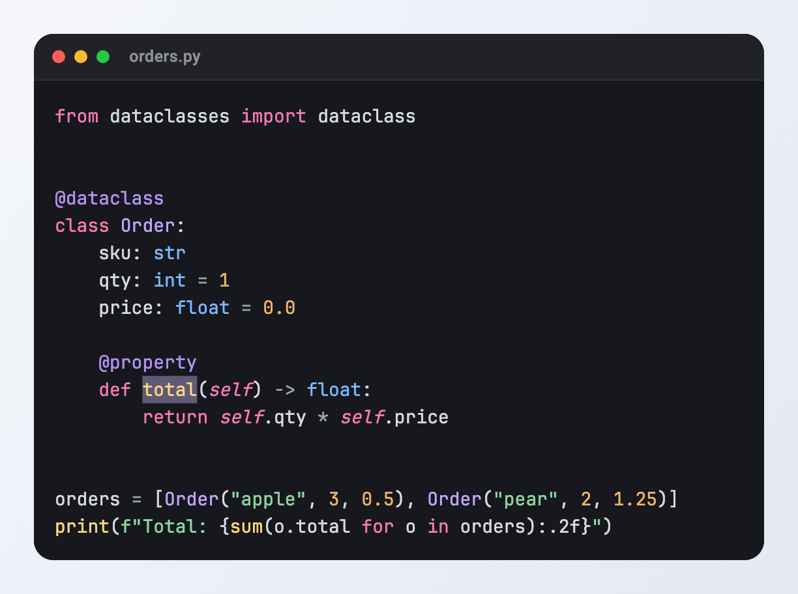

import { Card, CardGrid, LinkCard } from '@astrojs/starlight/components'

```dart
// Flutter: show highlighted code
CodeView(source, language: dartLanguage)

// Pure Dart: highlighted HTML
final html = const Highlighter().toHtml(source, language: dartLanguage);
```

val_highlight is a syntax highlighter written in pure Dart. The same engine
runs in Flutter apps, on servers, in command-line tools and on the web, and a
companion package adds Flutter widgets to show code and to edit it.

| Package | Use it for |
|---|---|
| [`val_highlight`](https://pub.dev/packages/val_highlight) | The engine. 55 languages plus a generic fallback and plain text, flat tokens, incremental updates, language detection, 8 themes, VS Code theme import and HTML output. No Flutter dependency. |
| [`val_highlight_flutter`](https://pub.dev/packages/val_highlight_flutter) | Flutter widgets: `CodeView` to show code, `CodeField` to edit it, `HighlightTextController` for any `TextField`, and `CodeTheme` for app-wide defaults. Re-exports the core API of `val_highlight`. |

```bash
flutter pub add val_highlight_flutter val_highlight material_ui
```

Then follow [Getting started](/docs/getting-started/).

## What it draws

<div class="uv-shots">






</div>

Each image is one widget from `val_highlight_flutter`, framed as a small
window and rendered by the package's screenshot generator
([`tool/screenshots/`](https://github.com/useval/highlight/tree/main/val_highlight_flutter/tool/screenshots)).
JetBrains Mono stands in for the platform's monospace font.

## Why val_highlight

<CardGrid>
  <Card title="Pure Dart" icon="laptop">
    No native code, no WebView, no JavaScript. The engine's tests run on the
    Dart VM and compiled to JavaScript, and the widgets are plain Flutter text.
  </Card>
  <Card title="Incremental" icon="rocket">
    After an edit, only the lines it can affect are scanned again — what
    `CodeField` uses on every keystroke. See
    [incremental highlighting](/docs/engine/incremental/).
  </Card>
  <Card title="Small imports" icon="puzzle">
    Every language and theme is its own `const` import, so an app ships the
    ones it uses. `languages/all.dart` brings in all of them.
  </Card>
  <Card title="Yours to change" icon="setting">
    Add keywords, put your own rules first, write a grammar from building
    blocks, adjust a theme or import one from VS Code — with the API the
    built-in languages use.
  </Card>
</CardGrid>

## What is in the box

- **[CodeView](/docs/components/code-view/)** — read-only code with line
  numbers, highlighted lines, wrapping or horizontal scrolling, selection that
  never copies line numbers, a header slot, tappable tokens and custom spans.
  Long files render lazily; large inputs are highlighted in a background
  isolate.
- **[CodeField](/docs/components/code-field/)** — an editor: brackets and
  quotes close themselves, Enter keeps the indentation, Tab and Shift+Tab
  indent, Ctrl+/ (Cmd+/ on macOS and iOS) toggles comments, the bracket
  pair at the caret is marked, and line numbers follow wrapped lines.
- **[Languages](/docs/languages/)** — 55, plus `genericLanguage`, which
  highlights what most languages share, and `plainTextLanguage`. HTML
  highlights its `<style>` and `<script>` content; Markdown highlights each
  fenced block in its own language.
- **[Themes](/docs/themes/)** — 8 built in, each tested for WCAG contrast;
  `ValTheme.fromVsCodeJson` reads a VS Code color theme.
- **[HTML output](/docs/engine/html/)** — CSS classes with a generated
  stylesheet, or inline styles.
- **[Tokens](/docs/engine/highlighting/)** — two flat integer lists that
  cover the source with no gaps, each token with a scope stack such as
  `string > interpolation`, plus the questions an editor asks: the matching
  bracket, and whether a position is inside a string or comment.

## Where next

<CardGrid>
  <LinkCard title="Getting started" description="Install, show code in Flutter, or render HTML in Dart." href="/docs/getting-started/" />
  <LinkCard title="Flutter widgets" description="CodeView, CodeField and a highlighted TextField, with previews and their code." href="/docs/components/" />
  <LinkCard title="Languages" description="Every language, its names and its files." href="/docs/languages/" />
  <LinkCard title="Themes" description="The built-in themes side by side, app-wide defaults and VS Code themes." href="/docs/themes/" />
</CardGrid>

The engine's code samples in these pages are mirrored in
[`val_highlight/test/docs/snippets_test.dart`](https://github.com/useval/highlight/blob/main/val_highlight/test/docs/snippets_test.dart),
which checks the results the pages quote. The API reference at the end of
each page, the language and theme lists and the scope table are generated
from the source, and a test fails when they fall behind.
